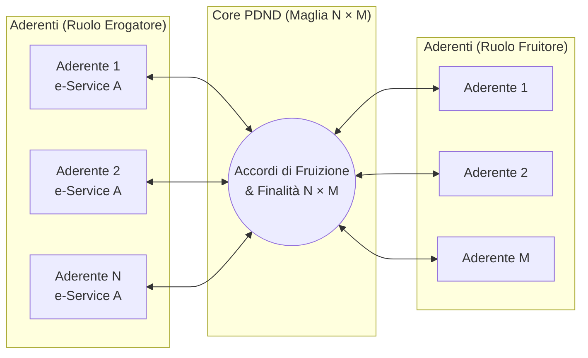
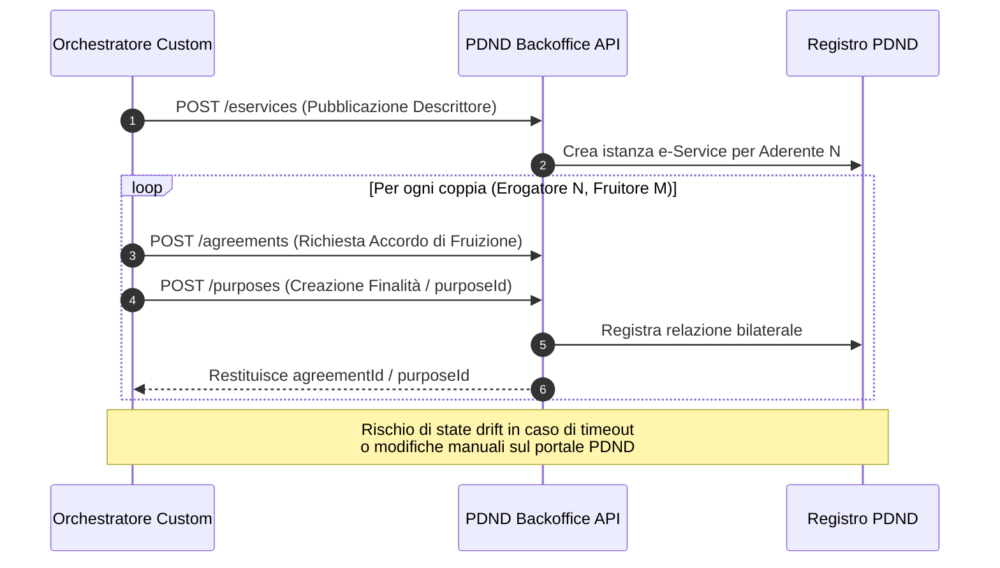

# 01_AS-IS - Analisi critica degli strumenti PDND per scenari Many-to-Many

In uno scenario architetturale **Many-to-Many** (o federato, tipico di reti regionali, unioni di comuni o piattaforme verticali), molteplici **Aderenti** operano contemporaneamente nel doppio ruolo di **Erogatore** e **Fruitore** sui medesimi **e-Service**. Poiché l'infrastruttura della **Piattaforma Digitale Nazionale Dati (PDND)** si fonda nativamente su un modello relazionale bilaterale (*1 Erogatore ↔ 1 Fruitore*), la scalabilità di tale topologia comporta l'esplosione combinatoria degli **Accordi di Fruizione** ($N \times M$) e delle relative **Finalità (Purpose)**.

Per mitigare tale complessità nel paradigma attuale (*AS-IS*), si ricorre a una combinazione di **strumenti nativi previsti dalle Linee Guida PDND** e **pattern di standardizzazione dei Descrittori**. L'analisi tecnica evidenzia tuttavia limiti strutturali e operativi significativi su larga scala:

## 1. Sistema delle Deleghe (Governance Amministrativa)
Previsto dalle Linee Guida PDND per disaccoppiare la titolarità giuridica dalla gestione operativa, consente a un **Aderente Delegante** di conferire a un **Soggetto Delegato** (es. Regione, Unione di Comuni, società *in-house*) il mandato per amministrare il ciclo di vita degli **e-Service** e degli **Accordi di Fruizione**.
* **Limiti strutturali:**
  * **Traslazione, non riduzione, della cardinalità:** La delega centralizza l'operatività sul **Soggetto Delegato**, ma non riduce la cardinalità logica delle entità su PDND. Ogni **Aderente Delegante** mantiene la propria identità giuridica, generando istanze distinte di **e-Service** e relative richieste di fruizione.
  * **Collo di bottiglia operativo sul Soggetto Delegato:** L'ente capofila deve governare un volume elevato di configurazioni per conto terzi, assorbendo l'onere gestionale di decine o centinaia di istanze parallele.
  * **Frammentazione dei flussi di audit:** La separazione tra titolarità del dato (in capo al singolo **Aderente**) e gestione tecnica sul catalogo complica i processi di revoca, subentro e rendicontazione.

## 2. API di Gestione (Backoffice API) e Orchestrazione Esterna
Le **API di Gestione (Backoffice API)** di PDND espongono interfacce programmatiche per automatizzare la pubblicazione dei **Descrittori** degli **e-Service**, l'invio e l'approvazione degli **Accordi di Fruizione**, la gestione degli **Attributi** e la creazione delle **Finalità**.
* **Limiti strutturali:**
  * **Necessità di un orchestratore esterno custom:** Poiché PDND non dispone nativamente di un'entità di raggruppamento federato, il progetto richiede la progettazione, lo sviluppo e la manutenzione evolutiva di un **motore di provisioning esterno**.
  * **Proliferazione dei `purposeId` e disallineamenti di stato:** L'automazione della maglia $N \times M$ genera un numero elevato di `agreementId` e `purposeId` distinti. Eventuali anomalie di rete, timeout o interventi manuali sul portale PDND causano *state drift* tra il database dell'orchestratore e il registro PDND, imponendo complesse logiche di riconciliazione.
  * **Accoppiamento stretto con le Backoffice API:** Ogni evoluzione o *breaking change* delle API di gestione PDND richiede interventi di adeguamento sull'orchestratore per evitare blocchi nei flussi di onboarding.

## 3. Attributi Certificati, Verificati e Policy di Attivazione
L'associazione di **Attributi Certificati** (attestati da fonti autoritative come IPA) o **Attributi Verificati** (attestati da un **Aderente Certificatore**) ai requisiti di fruizione degli **e-Service** abilita l'approvazione automatica degli **Accordi di Fruizione** senza istruttoria manuale.
* **Limiti strutturali:**
  * **Rigidità della granularità delle policy:** Gli **Attributi** modellano efficacemente appartenenze a categorie statiche (es. "Comune", "ASL"), ma risultano rigidi quando le regole di accesso dipendono da perimetri territoriali, funzionali o organizzativi dinamici.
  * **Governance del ciclo di vita dell'Attributo:** In assenza di un **Attributo Certificato** nativo su IPA, è necessario istituire un **Aderente Certificatore** dedicato alla verifica, assegnazione e revoca tempestiva degli **Attributi Verificati**, introducendo ulteriore carico amministrativo e tecnico.
  * **Assenza di verifica tecnica ex-ante:** L'auto-approvazione elimina l'attrito amministrativo, ma priva l'**Erogatore** di un controllo preventivo sull'effettiva conformità tecnica e di capacità del **Fruitore**.

## 4. Standardizzazione dei Descrittori e Pattern Asincroni (Signal Hub)
In assenza di un livello di intermediazione tecnica centralizzato, l'interoperabilità si affida alla definizione di un **Descrittore** (specifica OpenAPI conforme ai pattern di sicurezza e interoperabilità **ModI**) condiviso e, per i flussi ad eventi, al **Signal Hub** di PDND (pattern *Publish/Subscribe*).
* **Limiti strutturali:**
  * **Deriva delle implementazioni (*Implementation Drift*):** La pubblicazione di una specifica OpenAPI di riferimento non garantisce la piena omogeneità delle implementazioni presso decine di **Erogatori**. Difformità nella gestione degli errori HTTP, nei payload o nelle semantiche applicative ricadono sui **Fruitori**, costretti a implementare logiche di adattamento specifiche per singolo **Erogatore**.
  * **Onere tecnologico ModI distribuito:** Ciascun **Aderente** deve implementare, esporre e manutenere autonomamente l'intero stack di interoperabilità **ModI** (autenticazione mTLS, validazione dei **Voucher** PDND, generazione e verifica dei token di audit/integrità, rate limiting), con impatti rilevanti su costi, competenze e *time-to-market*.
  * **Complessità topologica con Signal Hub:** Sebbene il **Signal Hub** elimini il *polling* continuo, in uno scenario *Many-to-Many* ogni **Fruitore** deve sottoscrivere i flussi di notifica di molteplici **Erogatori** ed eseguire successivamente chiamate puntuali verso ciascun endpoint per il recupero del dato, moltiplicando i punti di integrazione e la gestione delle code di *retry*.

---

## Sintesi dei limiti nel modello Many-to-Many nativo (AS-IS)

| Livello Architetturale | Meccanismo LLGG PDND | Limite strutturale nel modello $N \times M$ |
| :--- | :--- | :--- |
| **Governance** | **Sistema delle Deleghe** + **Attributi Certificati/Verificati** | Non riduce la cardinalità delle relazioni ($N \times M$); concentra il carico operativo sul **Soggetto Delegato** e presenta rigidità nella granularità degli attributi. |
| **Provisioning** | **PDND Backoffice API** (Orchestratore custom) | Impone sviluppo e manutenzione di un motore esterno soggetto a *state drift* e proliferazione di `agreementId` e `purposeId`. |
| **Semantica e Contratti** | **Descrittori OpenAPI** standardizzati | Elevato rischio di *implementation drift* tra i diversi **Erogatori**, con onere di gestione delle eccezioni a carico dei **Fruitori**. |
| **Trasporto e Sicurezza** | **Esposizione distribuita ModI** + **Signal Hub** | Stack di sicurezza (**Voucher**, audit **ModI**, mTLS) replicato su ogni **Aderente** e gestione frammentata delle sottoscrizioni asincrone. |