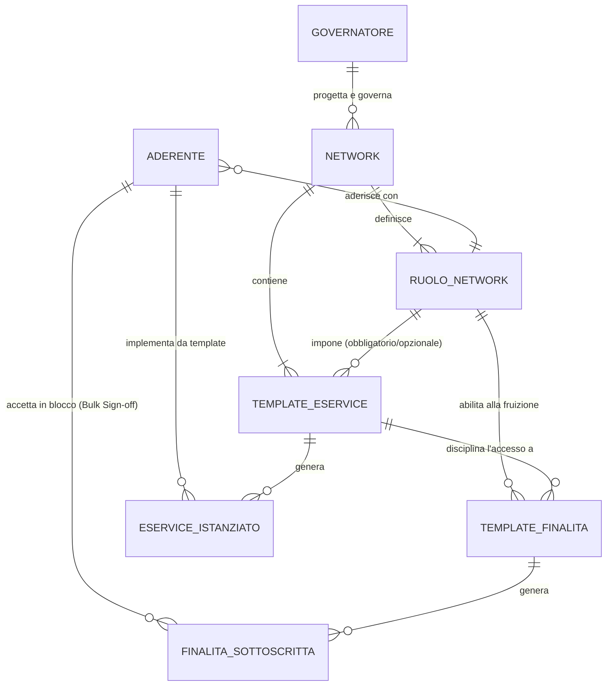
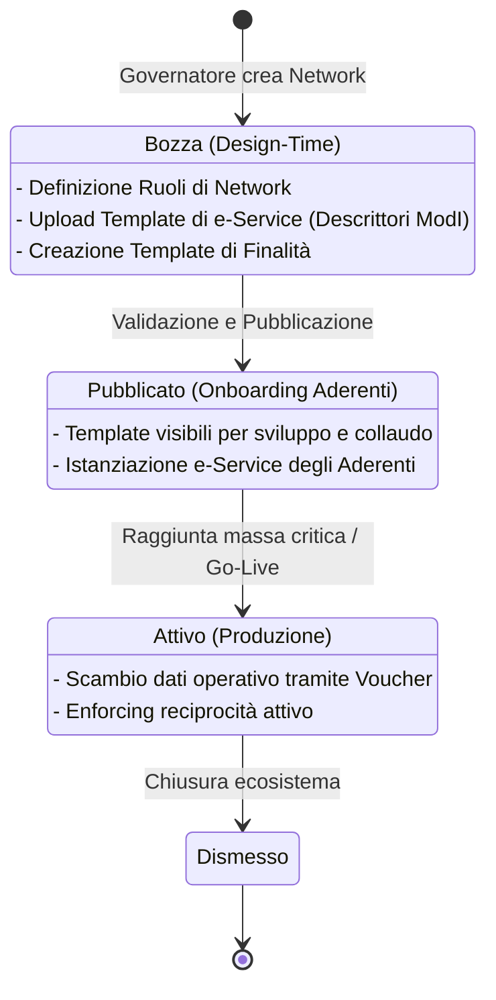
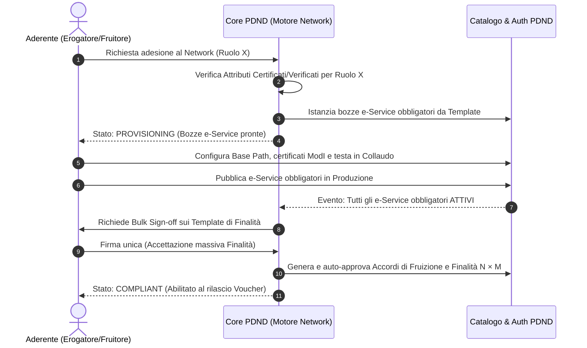
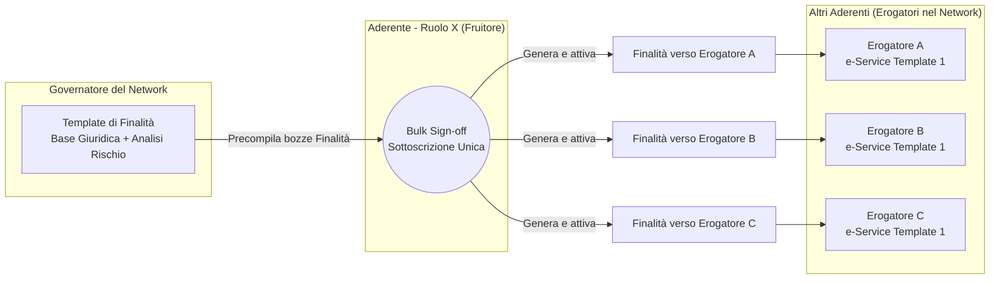
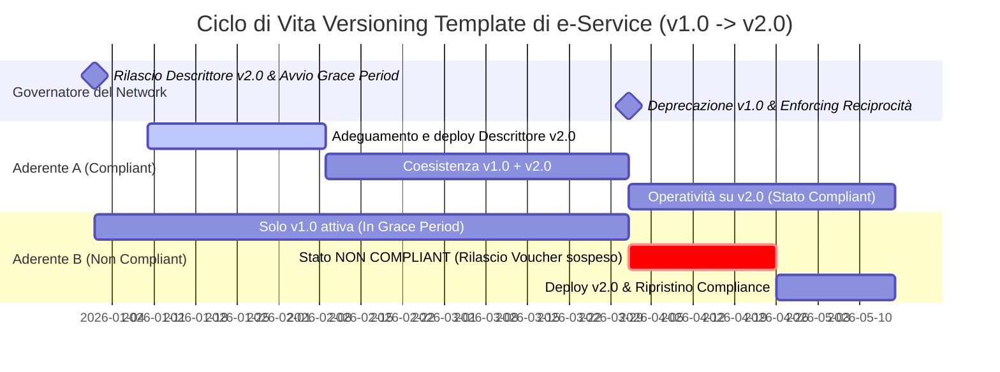

# 02_network_highlevel - Evoluzione TO-BE di PDND: Gestione dei Network Many-to-Many

## 1. Obiettivo e Visione Architetturale
L'attuale architettura della **Piattaforma Digitale Nazionale Dati (PDND)** si basa su un paradigma relazionale **bilaterale** (*1 Erogatore ↔ 1 Fruitore*). Quando decine o centinaia di **Aderenti** devono contemporaneamente erogare e fruire i medesimi **e-Service** (scenario *Many-to-Many*), tale modello genera un'esplosione combinatoria di **Accordi di Fruizione**, **Finalità (Purpose)** e configurazioni operative.

L'evoluzione architetturale proposta (*TO-BE*) introduce il concetto nativo di **Network** come entità di primo livello nel core di PDND, governato dalla figura del **Governatore del Network**. Questo approccio eleva PDND da catalogo di **e-Service** bilaterali ad abilitatore nativo di ecosistemi federati e interoperabili *by-design*.

---

## 2. Nuove Entità Core nel Dominio PDND

Per supportare nativamente il paradigma *Many-to-Many*, il modello di dominio di PDND viene esteso con cinque nuove entità architetturali:

1. **Network:** Contenitore logico e normativo che aggrega un ecosistema di **Aderenti** attorno a un dominio applicativo comune (es. *Rete Fascicolo Sanitario*, *Interoperabilità Tributaria Comuni*). Dispone di un ciclo di vita a stati (`Bozza`, `Pubblicato`, `Attivo`, `Dismesso`) e di requisiti di eleggibilità basati sugli **Attributi Certificati/Verificati**.
2. **Governatore del Network:** L'**Aderente** (es. AgID, Ministero, Regione, Ente Capofila) titolato a progettare, configurare e manutenere le regole del **Network** durante l'intero ciclo di vita, operando in modo disaccoppiato rispetto agli **Erogatori** e ai **Fruitori** fisici dei servizi.
3. **Ruolo di Network:** Profilo funzionale che un **Aderente** assume all'interno del **Network** (es. *Ente Emittente*, *Ente Verificatore*, *Nodo Centrale*). Definisce in modo dichiarativo la matrice degli **e-Service** da erogare obbligatoriamente e di quelli fruibili.
4. **Template di e-Service:** Definizione astratta e standardizzata di un **e-Service** (**Descrittore** OpenAPI conforme ai pattern **ModI**, semantica, policy di sicurezza e SLA) predisposta dal **Governatore del Network** in fase di *design-time*, priva degli endpoint fisici (*Base Path*) dei singoli **Erogatori**.
5. **Template di Finalità (Purpose Template):** Schema precompilato dell'analisi del rischio, della base giuridica e dei volumi di traffico stimati, associato a un **Template di e-Service** per uno specifico **Ruolo di Network**.

### Diagramma Entità-Relazione (ER) del Modello TO-BE

---

## 3. Processi Chiave e Meccanismi Operativi

### 3.1 Fase di Design-Time (Setup Preventivo)
Prima dell'apertura alle adesioni, il **Governatore del Network** configura l'ecosistema in ambiente di progettazione:
* Definisce i **Ruoli di Network** ammessi e i relativi requisiti di eleggibilità (**Attributi Certificati/Verificati**).
* Carica e valida i **Template di e-Service** (**Descrittori** OpenAPI univoci conformi a **ModI**), rendendoli immediatamente consultabili dagli **Aderenti** per avviare gli sviluppi tecnici prima del *go-live*.
* Associa a ciascun **Ruolo di Network** la matrice di **obbligatorietà** (**e-Service** da implementare in qualità di **Erogatore**) e la matrice di **fruibilità** (**e-Service** consumabili in qualità di **Fruitore**), collegando i relativi **Template di Finalità**.

### 3.2 Onboarding Progressivo e Reciprocità By-Design
Per evitare blocchi operativi (*all-or-nothing*) durante le fasi di sviluppo e collaudo, garantendo al contempo che nessun **Aderente** fruisca dati senza aver adempiuto ai propri obblighi di erogazione, l'adesione segue una macchina a stati governata dal core di PDND:

1. **Adesione Amministrativa (`Onboarding`):** L'**Aderente** richiede l'ingresso nel **Network** selezionando un **Ruolo di Network**. PDND verifica automaticamente il possesso degli **Attributi Certificati/Verificati** associati al ruolo.
2. **Istanziazione Guidata (`Provisioning / Collaudo`):** PDND istanzia automaticamente sul catalogo dell'**Aderente** le bozze degli **e-Service** obbligatori derivati dai rispettivi **Template di e-Service**. L'**Erogatore** eredita il **Descrittore** standardizzato e configura esclusivamente il proprio endpoint (*Base Path*), i certificati **ModI** e i parametri di collaudo.
3. **Attivazione e Reciprocità (`Attivo / Compliant`):** Quando tutti gli **e-Service** obbligatori previsti per il **Ruolo di Network** risultano pubblicati e attivi in produzione, PDND abilita automaticamente l'**Aderente** (in qualità di **Fruitore**) a richiedere **Voucher** verso gli altri **Erogatori** del **Network**. Qualora un **Erogatore** sospenda o dismetta un **e-Service** obbligatorio, i suoi privilegi di fruizione nel **Network** vengono revocati automaticamente.

### 3.3 Finalità Ereditate e "Bulk Sign-off" (Accountability GDPR)
Per conciliare l'automazione del provisioning con il principio di *accountability* previsto dal GDPR (che impone a ciascun Titolare del Trattamento l'assunzione formale di responsabilità sull'accesso ai dati), l'attivazione delle **Finalità** non è silente ma **precompilata e sottoscritta in blocco**:
* All'atto dell'adesione per un determinato **Ruolo di Network**, PDND genera le bozze di **Finalità** basate sui **Template di Finalità** predisposti dal **Governatore del Network**.
* L'**Aderente** (tramite il proprio delegato abilitato) esegue un **Bulk Sign-off** (accettazione massiva con un'unica azione di conferma), sottoscrivendo formalmente base giuridica e analisi del rischio per tutti gli **e-Service** fruibili dal proprio ruolo.
* A ogni successivo ingresso di un nuovo **Erogatore** nel **Network**, gli **Accordi di Fruizione** e le **Finalità** verso gli **Aderenti** già `Compliant` vengono propagati automaticamente senza richiedere nuove istruttorie.

### 3.4 Evoluzione e Versioning dei Template di e-Service
Il **Governatore del Network** governa l'evoluzione delle interfacce pubblicando nuove versioni dei **Descrittori** all'interno dei **Template di e-Service** (es. passaggio da `v1.0` a `v2.0`):
* Il **Governatore del Network** configura una **finestra di migrazione (*Grace Period*)** e una **data di deprecazione** per la versione precedente del **Descrittore**.
* PDND notifica automaticamente tutti gli **Aderenti** il cui **Ruolo di Network** include quel template, avviando il periodo di adeguamento.
* Durante il *Grace Period*, le versioni `v1.0` e `v2.0` coesistono garantendo la continuità operativa; alla scadenza, gli **Aderenti** che non hanno attivato la versione `v2.0` transitano nello stato `Non Compliant`, con sospensione temporanea del rilascio **Voucher** nel **Network** fino al completamento dell'adeguamento.

---

## 4. Confronto Sintetico: Modello Attuale (AS-IS) vs Modello Network (TO-BE)

| Dimensione Architetturale | Modello Attuale (AS-IS) | Modello Network (TO-BE) |
| :--- | :--- | :--- |
| **Paradigma relazionale** | Bilaterale (*1 Erogatore ↔ 1 Fruitore*). | Ecosistemico (*Many-to-Many* governato da **Ruoli di Network**). |
| **Definizione Descrittori** | Ogni **Erogatore** pubblica autonomamente il proprio **Descrittore** OpenAPI (rischio di *implementation drift*). | **Template di e-Service** con **Descrittori ModI** univoci precaricati dal **Governatore del Network**. |
| **Obblighi di erogazione** | Nessun vincolo sistemico: un **Aderente** può operare esclusivamente come **Fruitore**. | **Reciprocità by-design**: rilascio **Voucher** abilitato solo ad attivazione degli **e-Service** obbligatori del ruolo. |
| **Gestione Finalità** | Creazione e approvazione bilaterale $1 \times 1$ per ciascun **Accordo di Fruizione**. | **Template di Finalità** con **Bulk Sign-off** unico e propagazione automatica. |
| **Governance** | Distribuita sui singoli **Aderenti** (o tramite **Soggetto Delegato** / orchestratori custom). | **Nativa nel core PDND** tramite il **Governatore del Network**. |
| **Gestione Cambiamenti** | Coordinamento manuale tra coppie di **Aderenti** per l'aggiornamento dei **Descrittori**. | **Versioning centralizzato** dei **Template di e-Service** con *Grace Period* gestito da PDND. |