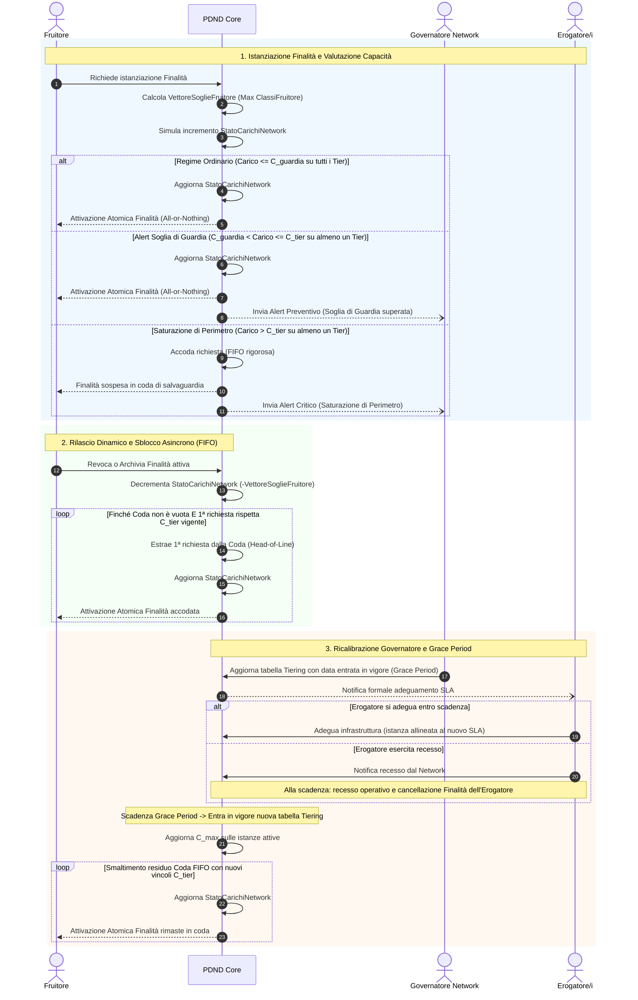

# 03 - Gestione della Capacità e dei Carichi nei Network PDND (TO-BE)

## 1. Analisi del Problema: L'Asimmetria Infrastrutturale e il Vincolo di Atomicità nel Modello Many-to-Many

Nel modello bilaterale tradizionale della **Piattaforma Digitale Nazionale Dati (PDND)** (*1 Erogatore ↔ 1 Fruitore*), la sostenibilità infrastrutturale è governata tramite negoziazione puntuale: l'**Erogatore** dichiara nel **Descrittore** dell'**e-Service** una capacità massima giornaliera ($C_{max}$) e per ciascun aderente. Per le singole **Finalità (Purpose)**, in cui il *Fruitore* indica le proprie **stime di utilizzo**, se le capacità indicate sono rispettate non è richiesta alcuna azione all'**Erogatore**; viceversa, l'**Erogatore** verifica la possibilità di accettare la richiesta lasciando in sospeso la **Finalità** (approccio **cautelativo per l'Erogatore**).

In un ecosistema **Network** (*Many-to-Many*), caratterizzato da adesioni automatizzate, decine o centinaia di **Aderenti** interconnessi e dalla necessità di garantire l'**attivazione atomica (*All-or-Nothing*)** delle **Finalità** su tutte le istanze di e-Service del Network, tale modello presenta tre criticità strutturali:

1. **Asimmetria dimensionale degli Aderenti:** Soggetti che ricoprono il medesimo **Ruolo nel Network** (es. tutti i Comuni italiani) dispongono di capacità infrastrutturali e bacini d'utenza profondamente eterogenei (es. Roma Capitale rispetto a un Comune di 500 abitanti).
2. **Saturazione silenziosa (*Overbooking*) e barriere all'ingresso:** Imporre una capacità fissa uniforme lato **Erogatore** escluderebbe i piccoli enti privi di infrastrutture ad alta capacità, mentre lasciare ai singoli **Erogatori** la discrezionalità di dichiarare capacità arbitrarie al ribasso causerebbe saturazioni locali, compromettendo l'attivazione simultanea (*All-or-Nothing*) su tutto il Network.
3. **Inadeguatezza delle stime di carico statiche ed uniformi lato Fruitore:** Il **Governatore del Network** non può fissare un unico valore assoluto di consumo nei template per tutti i **Fruitori**, poiché il volume di traffico generato dipende sia dalla dimensione del richiedente sia dal bacino dati dell'**Erogatore** interrogato.

## 2. Modello Risolutivo a Tre Livelli (Doppio Tiering Speculare)

Per garantire l'attivazione istantanea e atomica (*All-or-Nothing*) delle **Finalità** su tutte le istanze di **e-Service** collegate, eliminando la discrezionalità dei singoli **Erogatori**, senza creare barriere all'ingresso per gli enti di minori dimensioni, e dei singoli **Fruitori**, evitando un'elevata distonia tra la stima indicata e il reale utilizzo di un **e-service**, l'architettura introduce un motore di **Capacity Management Deterministico a Doppio Tiering** articolato su tre livelli:

### 2.1 Tiering Capacitivo sui Template di e-Service ($C_{net, j}$)

La capacità delle istanze di **e-Service** non viene impostata manualmente dall'**Erogatore** né fissata come valore unico uguale per tutti, bensì determinata automaticamente tramite una **tabella di parametrizzazione (*Tiering*)** definita dal **Governatore del Network** e ancorata agli **Attributi Certificati** dell'Erogatore $j$. 

La **tabella di parametrizzazione (*Tiering*)** è definita dalla disgiunzione logica (OR) di **Attributi Certificati** standard o discreti. 

Nel caso di **Attributi Certificati** standard, ad esempio *Province*, il **Governatore del Network** definisce la capacità che gli **Erogatori** in possesso dello stesso devono assicurare. 

Nel caso di **Attributi Certificati** discreto, ad esempio *Popolazione Comuni*, il **Governatore del Network** definisce le fasce di interesse e per le stesse la capacità che gli **Erogatori** appartenenti alla fascia devono assicurare. 

Di seguito un esempio di configurazione:

| Tier Erogatore | Tipo Attributo Certificato | Criterio di appartenenza | Capacità Vincolante Ereditata |
| :--- | :--- | :--- | :--- |
| **Tier Comune Small** | discreto *Popolazione Comuni* | $< 5.000$ abitanti | $2.000$ chiamate/giorno |
| **Tier Comune Medium** | discreto *Popolazione Comuni* | $5.000 - 50.000$ abitanti | $15.000$ chiamate/giorno |
| **Tier Comune Large** | discreto *Popolazione Comuni* |$50.001 - 250.000$ abitanti | $75.000$ chiamate/giorno |
| **Tier Comune Metro** | discreto *Popolazione Comuni* | $> 250.000$ abitanti | $300.000$ chiamate/giorno |
| **Tier Province** | standard *Province* | in possesso | $350.000$ chiamate/giorno |

Il Governatore definisce la **tabella di parametrizzazione (*Tiering*)** per singolo **Template di e-Service**.

In fase di istanziazione dell'**e-Service** da parte di un **Erogatore**, PDND individua *CapacitaErogatore* = {*Capacità* per cui l'**Erogatore** soddisfa il criterio di appartenenza} e popola il parametro della capacità massima giornaliera ($C_{max}$) nel **Descrittore** come il $Max(CapacitaErogatore)$, senza possibilità di modifica da parte dell'**Erogatore**, ma aggiornabile dal sistema (PDND Core) a seguito di una ricalibrazione del Governatore. 

> OPEN POINT: La valutazione della capacità massima giornaliera avviene **in modo fisso al momento dell'istanziazione** dell'e-Service e rimane invariata anche a fronte di eventuali aggiornamenti successivi degli Attributi Certificati dell'ente.

### 2.2 Stima Parametrica dei Carichi sui Template di e-Service ($S_{i,j}$)

In modo speculare, il **Template di e-Service** non contiene un valore numerico statico in merito al consumo dei **Fruitori**, ma associa al **Fruitore** $i$ una stima di traffico proporzionata ai propri **Attributi Certificati** e modulata rispetto alla classe dimensionale dell'**Erogatore**. 

In pratica il **Governatore del Network** associa una **Matrice Bidimensionale di Carico (Erogatore/Fruitore)** in cui le due dimensioni sono definite dalla disgiunzione logica (OR) di **Attributi Certificati** standard o discreti. Si impone che la dimensione Erogatore sia simmetrica alla **tabella di parametrizzazione (*Tiering*)**.

Nel caso di **Attributi Certificati** standard, ad esempio *Province*, il **Governatore del Network** definisce il consumo di cui i **Fruitori** in possesso dello stesso possono beneficiare.

Nel caso di **Attributi Certificati** discreto, ad esempio *Popolazione Comuni*, il **Governatore del Network** definisce le fasce di interesse e per le stesse il consumo di cui i **Fruitori** appartenenti alla fascia possono beneficiare.

Di seguito un esempio di configurazione:

| Classe Fruitore / Classe Erogatore | **Tier Comune Small** (< 5k ab.) | **Tier Comune Medium** (5k - 50k ab.) | **Tier Comune Large** (50k - 250k ab.) | **Tier Comune Metro** (> 250k ab.) | **Tier Province** |
| :--- | :---: | :---: | :---: | :---: | :---: |
| **Tier Comune Small** (< 5k ab.) | 5 ch./gg | 20 ch./gg | 50 ch./gg | 100 ch./gg | 200 ch./gg |
| **Tier Comune Normal** (5k - 250k ab.) | 15 ch./gg | 150 ch./gg | 500 ch./gg | 1.000 ch./gg | 2.000 ch./gg |
| **Tier Comune Metro** (> 250k ab.) | 30 ch./gg | 500 ch./gg | 2.500 ch./gg | 5.000 ch./gg | 10.000 ch./gg |
| **Tier Province** (in possesso) | 50 ch./gg | 2.000 ch./gg | 10.000 ch./gg | 20.000 ch./gg | 40.000 ch./gg |

In fase di istanziazione della **Finalità** da parte di un **Fruitore**, PDND individua a quali **Classi Fruitore** lo stesso appartiene (*ClassiFruitore*) e determina il vettore delle soglie per ciascuna Classe Erogatore (*VettoreSoglieFruitore*) come i massimi delle *ClassiFruitore* per singola **Classe Erogatore**.

> OPEN POINT: Anche per il **Fruitore**, la risoluzione della classe dimensionale e l'assegnazione delle relative stime avvengono **in modo fisso al momento dell'istanziazione** della Finalità, restando stabili nel tempo indipendentemente da eventuali variazioni successive degli Attributi Certificati dell'ente.

### 2.3 Attivazione Atomica (*All-or-Nothing*) e Governance Dinamica dei Volumi

PDND Core governa a runtime la crescita effettiva dei carichi aggregati per tipologia di Tier Erogatore assicurando di:
1. tenere traccia dei carichi aggregati di ogni tipologia di Tier Erogatore (*StatoCarichiNetwork*) che rappresenta il carico massimo teorico sul singolo Erogatore-tipo di ciascun Tier;
2. alla istanziazione di una nuova **Finalità** incrementare i carichi aggregati per tipologia di Tier Erogatore utilizzando il *VettoreSoglieFruitore*.

Poiché in un ecosistema aperto il **Governatore del Network** non può conoscere a priori il numero esatto e la distribuzione futura dei **Fruitori** (perimetro dinamico), il dimensionamento indicato ai precedenti paragrafi 2.1 e 2.2 rappresenta una **stima di esercizio ordinaria**. Ne deriva che PDND Core alla istanziazione di una nuova **Finalità** può trovarsi nelle seguenti situazioni:

- **Regime Ordinario**, l'incremento non rompe i vincoli imposti dalla **tabella di parametrizzazione (*Tiering*)** (per ogni Tier Erogatori è rispettato il vincolo di capacità), in questo caso PDND Core attiva la nuova finalità ed aggiorna *StatoCarichiNetwork*;

- **Alert Soglia di Guardia**, si presentano le circostanze della situazione **Regime Ordinario**, ma per almeno un Tier Erogatore il carico aggregato supera la **Soglia di Guardia** definita dal **Governatore del Network** (espressa come **soglia percentuale** unica per il Network, es. $80\%$ della capacità massima). In questo caso, PDND Core attiva comunque la nuova **Finalità**, aggiorna *StatoCarichiNetwork* e invia un **Alert Preventivo** al **Governatore del Network** affinché possa intervenire proattivamente prima di raggiungere la saturazione. Per determinare tale condizione, PDND Core:
   - calcola la capacità di guardia di ciascun Tier Erogatore moltiplicando il valore della **tabella di parametrizzazione (*Tiering*)** per la **Soglia di Guardia** (es. $C_{guardia} = C_{tier} \times \text{Soglia}_{\%}$);
   - verifica se il nuovo valore di *StatoCarichiNetwork* supera $C_{guardia}$ per almeno un Tier Erogatore.

- **Saturazione di Perimetro**, l'incremento rompe almeno uno dei vincoli imposti dalla **tabella di parametrizzazione (*Tiering*)** (per almeno un Tier Erogatori non è rispettato il vincolo di capacità), in questo caso PDND Core applica il **blocco atomico di salvaguardia**: l'attivazione della **Finalità** viene sospesa e accodata per il nuovo **Fruitore** sull'intero Network (evitando attivazioni parziali tra sottoinsiemi di Erogatori) e viene inviato un **Alert Critico** al **Governatore**.

#### Protocollo di Ricalibrazione e Adeguamento Infrastrutturale

Al superamento della Soglia di Guardia (per prevenire la saturazione) o in caso di blocco atomico (per sbloccare le richieste accodate), il **Governatore del Network** provvede all'**Innalzamento dei valori della tabella di parametrizzazione (*Tiering*) con Finestra di Adeguamento (*Grace Period*):**: il Governatore aggiorna la tabella sul/i **Template di e-Service** interessato/i fissando una **data di entrata in vigore differita** (finestra di adeguamento). Durante il *Grace Period*:
   * Gli **Erogatori** impattati ricevono notifica formale e adeguano la propria infrastruttura, aggiornando la propria istanza al nuovo SLA entro la scadenza, oppure esercitando la facoltà di recesso dal ruolo di Erogatore nel Network qualora non possano sostenere il nuovo carico; **alla scadenza del *Grace Period***, l'effetto del recesso diviene operativo, tutte le **Finalità** collegate alle sue istanze di **e-Service** vengono cancellate e la responsabilità degli eventuali effetti sui **Fruitori** ricade sull'Erogatore stesso.
   * Allo scadere della finestra di adeguamento, una volta allineate tutte le istanze attive nel Network, PDND Core sblocca automaticamente e in modo atomico le eventuali richieste dei **Fruitori** rimaste in coda.

#### Rilascio Dinamico della Capacità e Sblocco Asincrono (Event-Driven Dequeue)

Qualora il Network si trovi in stato di **Saturazione di Perimetro** con una o più richieste di attivazione in coda, lo sblocco non dipende esclusivamente dall'intervento di ricalibrazione del Governatore, ma può avvenire anche in modo automatico a seguito di eventi di rilascio capacità:

* **Revoca o Archiviazione di Finalità:** Nel momento in cui un **Fruitore** attivo revoca o archivia una **Finalità** esistente sul Network, PDND Core decrementa immediatamente i carichi aggregati in *StatoCarichiNetwork* sottraendo il relativo *VettoreSoglieFruitore*.
* **Valutazione della Coda (FIFO rigorosa):** A fronte di ogni decremento di carico, il sistema valuta automaticamente se la capacità liberata è sufficiente a soddisfare i vincoli della **tabella di parametrizzazione (*Tiering*)** esclusivamente per la prima richiesta in attesa nella coda di salvaguardia, applicando una politica *First-In, First-Out* rigorosa con blocco in testa (*Head-of-Line Blocking*) a tutela dell'ordine cronologico di arrivo (evitando che richieste successive di minore entità scavalchino Fruitori accodati in precedenza). L'azione descritta è reiterata in presenza di disponibilità per consumare le richieste in coda.
* **Attivazione Atomica:** Se il vincolo risulta nuovamente rispettato su tutti i Tier Erogatori, PDND Core procede istantaneamente all'attivazione atomica (*All-or-Nothing*) della **Finalità** accodata, aggiorna *StatoCarichiNetwork* e notifica il **Fruitore**, senza richiedere azioni manuali al **Governatore del Network**.
* **Operatività durante il Grace Period:** Il meccanismo di sblocco asincrono opera in tempo reale anche in pendenza di una finestra di adeguamento (*Grace Period*) avviata dal **Governatore del Network**. In tale transitorio, la valutazione dei vincoli di capacità per lo smaltimento della coda FIFO viene effettuata rispetto ai valori della **tabella di parametrizzazione (*Tiering*)** *correntemente in vigore* (e non rispetto ai nuovi valori differiti, che diverranno applicabili solo alla scadenza del *Grace Period* per le eventuali richieste ancora in coda).

----

